# Boxing and quick draw

The player now uses a shared southpaw boxing stance in the world and the Copper
Spur. The right foot leads; the left straight is the rear power punch and the
right jab is the lead punch. Entering the stance locks onto the nearest eligible
target. A punch commits its facing through contact, so a moving opponent cannot
drag an extended fist onto somebody behind the player.

## Punches, defense and footwork

**Pause → Settings → Gamepad Controls** offers independent Standard/Defensive
boxing and Right Stick/R2 Trigger shooting preferences, saved on this device.
Start pauses, Y opens Settings, A selects, the D-pad navigates, and B goes back.
See [Gamepad controls](gamepad-controls.md) for both exact controller maps.

| Action | Touch | Keyboard | Standard gamepad |
| --- | --- | --- | --- |
| Left straight | L STRAIGHT | E | L2 / LT |
| Right jab | R JAB | R | R2 / RT |
| Left hook | L HOOK | Q | L1 / LB |
| Right hook | R HOOK | T | R1 / RB |
| Left upper-body sway | SWAY L | Space | X |
| Right upper-body sway | SWAY R | H | B |
| Duck forward | DUCK | C | Y |
| Lean back | LEAN BACK | V | A |
| Footwork | Left stick | WASD | Left stick |
| Directional guard | Right stick | Arrow keys or IJKL | Right stick |
| Leave boxing stance | WEAPON / STANCE icon | Tab | D-pad up |

Connected gamepads hide the combat tutorial panel, touch controls and stance
exit badge. D-pad up exits the stance, restoring the equipped weapon outdoors.
A is a lean-back slip in Standard and a left hook in Defensive; exit the
stance before pressing A to talk or use a scene interaction. In Standard each
shoulder controls its own hand, including R1's right-hook entry. Outside boxing,
ordinary A interactions and D-pad melee-tool cycling retain their existing
controls.

Tap and release an attack for the head. Hold for at least 180 ms to lower the
boxer's level and prepare a body shot, then release to throw it. Holding never
automatically throws or repeats a punch. The outdoor fist button follows the
same release rule when it first enters the stance.

Player strikes have faster windup, contact and recovery. Press the opposite
hand within 120 ms after a successful hit to chain a quicker, stronger follow-up.
The timing is measured when the button is pressed, so a held body shot can
also chain if released within 420 ms. Only one follow-up can be reserved for
each landed strike. Misses, blocks, late presses and repeated same-hand attacks
do not earn the combo bonus.

All four slips leave the feet planted unless movement is held. Left/right
sways add a collision-checked sidestep in the held direction and move the head
diagonally forward off a straight punch's centerline. Right slips move toward
the opponent and the boxer's right; left slips move forward and left. Against
an opponent north of the player, these read as northeast and northwest. The hips,
torso and shoulders turn with the head, bringing the southpaw's rear left
shoulder forward on a right slip and the lead right shoulder forward on a left
slip. Ducking folds the head and shoulders down over bent knees, foreshortens
the chest and exposes more of the pitched back. Leaning back pulls the head
and torso away. A timed forward duck clears head hooks only: straight head
punches lower their actual fist and elbow along the committed punch line to
catch the ducked head. Their horizontal reach and aim stay fixed, so an
opponent moving out of range or off the line still makes the punch miss.
Timed backward leans can clear an incoming head hook within punching range,
while body punches remain a threat in either posture.
Forward movement adds a step into the duck; backward movement adds a retreat
with the lean. These steps use the boxer's facing at the start of the slip and
do not add forward/back travel when the held movement opposes the chosen slip.

Press a different dodge direction during the current animation to link another
movement directly from the current pose, including while the head is returning
to guard. An early press during the first 95 ms still queues one direction until
the apex; any later press links immediately without an apex timing requirement.
The next segment blends the head, torso, shoulders and guard over
95 ms, without first resetting the stance. Opposite lateral slips roll slightly
forward and down across the centerline. The handoff samples the visible pose,
including any sway retained by a counter punch. Repeating or holding a direction
cannot extend it. All twelve different-direction pairs work
with the existing keyboard, touch and gamepad bindings. Linked head movement
continues the original optional step and its timing rather than adding another
full sidestep. Physical head/body contact still applies throughout the chain.

Throwing the opposite hand from a lateral sway links the head slip into the
counter's shoulder and hip turn. Real animated hurt geometry determines a
miss; dodging grants no blanket invulnerability. Forward ducks and backward
leans carry smoothly into a counter punch as the head returns to guard.
Hooks pivot the heel and hips; body punches lower the head,
shoulders and bent knees before contact while leaning forward toward the
opponent. The exposed back has curved cel shade planes and a visible nape;
hats tilt with the duck so their brims do not hide the new posture.
Skin and hair also foreshorten with the forward pitch, so the duck remains
visible on bare heads without moving the physical head joint.

During every player dodge, including linked movements and carried counters,
both of the player's own forearms and fists paint beneath the head and headwear.
Crossing incoming enemy arms paint above that completed silhouette through
contact and early recovery, including during a backward lean. Enemy arms retain
their normal position above their own head. Head and body punches still use
their real joints and hit tests; this layer change adds no extra hits or immunity.
The rest of the fighters and furniture retain their normal ground depth;
knocked-out bodies stay underneath standing fighters. Each hand still paints
once at the same contact point used by the combat solver.

| Body shot | Loading posture | Release |
| --- | --- | --- |
| Right jab | Duck forward and slightly left | Straight right body jab |
| Right hook | Duck forward/right and load the torso to the right | Unwind the shoulders into the right body hook |
| Rear left straight | Duck forward near the centerline | Straight left body punch |
| Rear left hook | Duck forward/left and load the left shoulder and torso left | Unwind into the left body hook |

Players and enemies share these forms. A held load continues smoothly through
release, including a body counter prepared during a previous punch's recovery.

Guard directions are relative to the boxer, independent of their facing:

| Stick direction | Protected area |
| --- | --- |
| Up | Face against straight punches |
| Down | Body center against straight punches |
| Up-left / up-right | Left / right head side against hooks |
| Down-left / down-right | Left / right body side against hooks |
| Left / right | Left / right outer ribs |

Changing into the correct guard within 140 ms of contact parries the punch,
flashes at the guard and knocks the attacker back into a **2.6-second standing
stun**. Holding the same direction keeps a block but does not refresh the parry
window. An attacking arm opens its own guard; the other arm can still protect
its selected area. Punches use the actual animated fist, forearm and head/body
geometry, including terrain scale, rather than a broad damage radius.

Real contact drives the comic effects: a layered yellow impact burst for a
landed punch, smaller cool sparks for a block, and a larger contrasting burst
and expanding ring for a parry. A missed punch produces no contact effect.

Boxers have body collision and take staggered attack turns. Three opponents
allow one attack at a time; a larger outdoor group can spend two separated
attack turns. Windups, recovery, guard gaps and counterattacks remain active.
Ordinary armed enemies retain their firearm behavior. World fists preserve
harmless civilian knockdowns and the existing four-hit hostile stun.

## Copper Spur

The room is now 1400 × 980 world units, about 2.7 times its previous area, with
a longer bar, six tables, gallery, piano, stairs and a clear fighting floor.
The close camera keeps the player and locked opponent readable. Player follow
and target anticipation are smoothed separately, so switching opponents does
not snap the view. Peacemaker now uses survival waves, separate GRIT and
nonlethal directional knockouts. Clearing level 14 awards the first-completion
75 score once; the run continues on the bridge. Pause, save and leave-to-shop
retain the outside equipment.
Knocked-out fighters use the ground pass beneath standing characters and
furniture, preserving their nonlethal falls and clothing. Outdoor nonlethal
bodies follow the same rule, including in the closed interiors.

GRIT remains visible in its own upper-left combat bar, above and outside the
information header, including between waves, during transitions and after a
knockout. The saloon's information panels and notices hold for 3.5 seconds, then fade
smoothly over 400 ms. A new bout, downed opponent or duel cue briefly reveals
the changed status; ordinary damage and guard input do not keep the panels
on screen. Pause freezes the fade, while mission menus and usable controls
stay visible. Leave Saloon appears only at the actual doorway outside a bar
fight or player knockout; duel results return to the saloon first. The pause
menu retains its deliberate leave-and-open-shop action.

### Peacemaker survival

| Level | Fighters | Behavior | Arena |
| --- | --- | --- | --- |
| 1 | One rookie | Single punches | Saloon |
| 2 | One brawler | Blocks and two-punch combinations | Saloon |
| 3 | Two rookies | Single punches | Saloon |
| 4 | Two brawlers | Blocks and two-punch combinations | Saloon |
| 5 | Three brawlers | Blocks and two-punch combinations | Saloon |
| 6 | Iron Jack | Blocks, head slips and three-punch combinations | Saloon |
| 7 | One brawler and Big Hank | Tackle through the door, then skilled combat | Main Street |
| 8 | Two brawlers and one ace | More attackers and faster turns | Main Street |
| 9 | One brawler and two aces | More three-punch chains and slips | Main Street |
| 10 | Two brawlers and two aces | Four attackers | Main Street |
| 11 | One brawler and three aces | More skilled attackers | Main Street |
| 12 | Two brawlers and three aces | Five attackers | Main Street |
| 13 | One brawler and four aces | More skilled attackers | Main Street |
| 14 | Six aces | Travelling reveal, then the bridge gauntlet | Canyon bridge |
| 15+ | Six to eight aces | Bounded growth in health and pressure | Canyon bridge |

Clearing a wave starts a 2.6-second finishing interval and restores 12 GRIT,
capped at 100. The player's same boxing rig stays active: the winning punch
completes its contact and recovery while the knocked-out fighter falls and
settles. Result panels wait at least two seconds and until that punch finishes;
GRIT and pause remain visible. Held attacks and queued combos are consumed
during the interval. The next wave retains the stance, including across the
street and bridge transitions. Remaining GRIT carries into the next wave;
campaign health does not heal.
Opponent combinations hold a single attack turn through their follow-up gaps.
Up to three attackers share one active turn; larger groups have two staggered
turns. Guard reactions are delayed and use actual forearm geometry. Head slips,
body openings, counter timing and parries remain physical, and a successful
parry interrupts the enemy's chain for the full 2.6-second stun.

After level 6, Big Hank charges and carries the player through the saloon door,
with local wood debris, an articulated landing and get-up. After level 13, a
travelling reveal moves the fight onto a timber crossing above layered canyon
walls. Input is held during transitions; pause freezes their clocks. The stage
boundaries also contain dodge steps and knockout physics. New attackers spawn
in clear, separated positions even when the player finishes near a railing.
At most twelve older knocked-out fighters remain in an arena's floor pass.

Best completed level is saved. A loaded game resumes at the exterior campaign
position with its original equipment; beginning a new gauntlet starts at level
1. Switching to a duel cannot interrupt a running wave, breather or cinematic.
Mae's menu resumes an active run, and the pause shop action can end it deliberately.

Leaving the stance during an active bar fight pauses the opponents' attack
turns while preserving their health, positions and the player's GRIT. Move
freely around the room and press A/F at Mae to interact. RAISE FISTS or a fresh
mapped controller/keyboard punch resumes the same bout; a held attack still throws only
when released. Leaving the stance does not abandon the mission or expose a
Leave Saloon button during the fight. Buttons held through entry, pause,
reconnection or stance exit must lift before they can become new slip presses.

Running out of GRIT stops the fight and knocks the actual player down where
the final punch lands. Player and enemy knockouts use a dedicated 120 Hz
Peacemaker ragdoll with five responses: back reel, side spill, hook twist,
knee fold and forward fold. Repeated identical blows cycle eligible responses;
body shots favor low forward folds, while hooks can twist or spill sideways.
Asymmetric arms and knees follow constrained springs, knees can buckle before
the torso, and short travel/lift settles into distinct floor poses. Paired
bodies in the scripted doorway tackle use a fixed local response. Civilian and
outdoor knockdowns retain their earlier directional fall and painter.
The player remains
down for at least 2.2 seconds before a 32-frame get-up, then can return to Mae
to retry. Opponents stop attacking during this sequence. The existing 12-health
nonfatal penalty applies once when the knockout begins; pausing freezes physics,
and saving or leaving for the shop restores the exterior equipment and position
without carrying a local ragdoll into the campaign. Floor-contact dust stays
inside the activity.

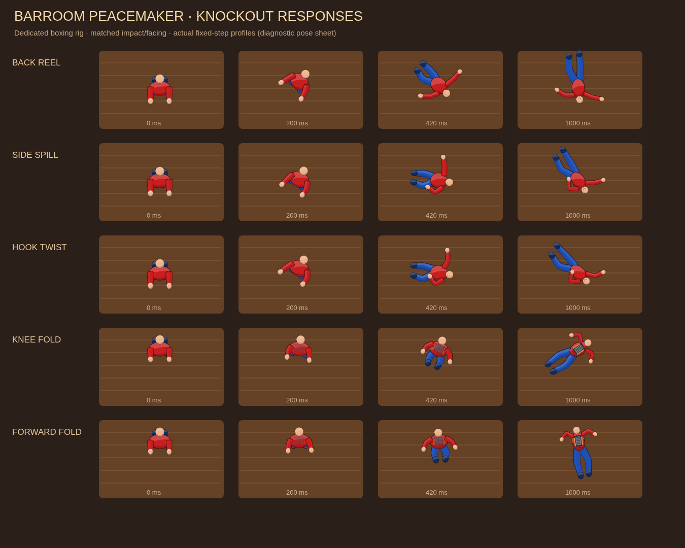

Outside, the sheriff heading holds for three seconds and fades over 400 ms.
The compact arrow/distance marker and usable wanted-board interaction remain.
Changing a contract briefly reveals the updated heading; walking does not
refresh its timer. Local activity notices are cleared when leaving the scene.

## Quick draw

With **Right Stick** shooting, the right stick aims below roughly **70%**
travel and fires when pushed farther. With **R2 Trigger** selected, the stick
only aims and R2 fires. Touch keeps its original outer fire ring. The visible
gun and projectile follow that direction. Aiming while WAIT is safe; firing
before DRAW loses. Desktop mouse aiming, Space/RT and the FIRE button remain
available. The target must actually be hit: a badly aimed round
can miss, and victory waits for finite projectile contact.

Each victory advances the saved challenge. The first duel starts at 380 world
units with a 700 ms normal draw deadline; subsequent opponents stand 55 units
farther away and draw progressively faster. Hard mode starts with 520 ms.
The first win awards 120 score and immediate cowboy costume ownership; later
wins advance the challenge without duplicating that reward.

Hits use the game's native corpse, wound, fall and death effects inside the
duel scene. Headshot deaths advance the normal shared 1 → 8 → 9 animation
sequence rather than always choosing the first variant. Both rival and player
headshot deaths advance it once; body deaths, misses, false starts and rematches
do not reset it. Separation and fragments animate on the duel's local clock,
without adding campaign kills or exterior corpses/stains. A player defeat shows
the same death animation through a local body, costs 12 outside health and keeps the minigame's rematch flow. Local
actors, bullets and effects do not alter campaign kills or outside combat.
Saving resumes outside with the challenge tier and exact weapon reserves.

## Verification

```sh
node tools/check-boxing-combat.js
node tools/check-boxing-render.js
node tools/check-boxing-world.js
node tools/check-boxing-refinements.js
node tools/check-boxing-feedback.js
node tools/check-boxing-gamepad-refinements.js
node tools/check-boxing-four-way-input.js
node tools/check-boxing-longitudinal-slips.js
node tools/check-boxing-ground-order.js
node tools/check-boxing-body-postures.js
node tools/check-frontier-saloon.js
node tools/check-saloon-quiet-hud.js
node tools/check-knockout-physics.js
node tools/check-world-knockdown-legacy.js
node tools/check-saloon-ragdoll-variety.js
node tools/check-frontier-duel-death-sequence.js
node tools/check-frontier-player-knockout.js
node tools/check-frontier-gauntlet.js
node tools/check-frontier-gauntlet-arenas.js
node tools/check-boxing-gauntlet-ai.js
node tools/check-frontier-hud-refinements.js
node tools/check-frontier-integration.js
```

Actual Chromium checks cover portrait and landscape touch layouts, simultaneous
move/guard/punch fingers, complete mobile bar fights, timed parries, world
stance entry/exit, aimed duel hits and misses, native death visuals and saved
challenge progression.

The refinement review also checks all four held BODY strikes at 390 × 844,
320 × 568 and 800 × 390, with no attack before release. A complete touchscreen
bout produced nine combo hits and two parries without editing health or moving
fighters by hand. Target switches moved the camera by at most 0.68 world units
on the first frame. Separate native contact checks verify block sparks with
zero damage, and outdoor entry preserves its original held finger until release.
Controller review checks real forearm parry contact and stun expiry: attacks
and sways stay disabled through 2599 ms and unlock at 2600 ms. Native saloon,
biome and closed-room render checks put an overlapping knocked-out actor
below the standing player and verify that each actor is painted once.
Body-posture checks cover all four forward/lateral loads, continuous held
release and earned counters, actual fist and guard contact, and canonical
rendering through 63 poses. Real browser review includes 48 player/enemy poses
and all four physical BODY holds and releases in portrait and landscape.

Knockout review uses real enemy punch contacts to lose two bouts at 390 × 844
and 940 × 390 with DPR 3. Both complete the fall, floor settle, pause/save,
get-up, retry and pause-to-shop sequence without rewriting GRIT or teleporting
fighters after the bout begins. The final source produces no browser errors
or frame faults. A native outdoor civilian punch also exercises the same rig
through its 933 ms settle. The quiet HUD capture is taken after four seconds;
usable touch controls remain, while a connected controller leaves pause and
the persistent GRIT bar.

Four-way slip review adds 218 physical pose/contact checks and 78 input checks.
Final Chromium runs at 390 × 844 and 940 × 390 with DPR 3 exercise real pad
edges and touch gestures: both head hooks miss well-timed ducks and leans,
early/late attempts and body shots still hit, and matching steps respect the
bar collision. Stance exit preserves the bout and consumes held A/D-pad presses;
fresh A interactions work after exit. Pause/reconnect checks preserve the
existing shoulder punch-release behavior. Both layouts have no browser errors
or frame faults, and the preview covers 24 rendered poses across three facings.

The anatomical-slip and persistent-GRIT refinement passed 1,030 checks across
20 focused suites. Chromium review at 390 × 844, 320 × 568 and 940 × 390,
all with DPR 3, verifies 28 native punch contacts: forward ducks clear both
head hooks while both straights connect. Twelve live gamepad slips retain
planted feet and turn the shoulders correctly; twelve moving-away/off-axis
cases remain true misses. The GRIT bar and northern bounty marker survive
their neighboring text fading naturally. Twenty-one fixed critical render
poses verify hook-over-duck depth in both actor orders and the shared head/fist
centers, with no browser errors or frame faults. These captures use desktop
Chromium mobile viewports; they do not measure performance on a Galaxy device.

The slip-depth and round-finish review covered 1,294 checks across 21 suites.
Native controller trials at 390 × 844 and 940 × 390 verify 40 left/right slips
against straights across five facings: crossing arms paint above the head and
torso once, while the physical head strikes miss. Finishing-contact fixtures
cover all four punches at both head and body height, preserving
ACTIVE → RECOVERY → READY on the same boxing rig, articulated falls, delayed
results and next-wave input. A native touch finish at 320 × 568 also retains
the same camera center and zoom through the KO, break and next wave. Captures
use directed low-health opponents to isolate the last contact; no knockout
or wave-clear seam is called to make them finish. Chrome reports no errors or
frame faults.

The initial linked-dodge and guard-depth review covered 2,568 checks across 23 suites,
including 547 apex, continuity and physical contact checks, 235 native input
checks and 672 production layer checks. Final Chrome review at the same three
mobile viewport sizes verifies all twelve direction changes with native
controller edges, continued multi-slip chains, real touch and keyboard links,
and mixed-posture counters that still land. Incoming head/body contacts remain
physical, and the player's own arms stay under their head at every sampled
handoff while crossing enemy arms stay above. Parry, pause, controller handoff,
stance exit, knockout and round finish discard pending links. Held buttons and
simultaneous chords cannot create repeated chains. The 2.6-second finishing
interval still preserves the same boxing rig. There are no browser errors or
frame faults; the six-pose detail preview fully frames the figures.

Recovery handoffs expand the same suites to 3,443 checks. All twelve direction
pairs accept late inputs at 206, 300 and 429 ms, including native keyboard,
touch and gamepad presses. Handoffs preserve the full rendered pose even when
a counter punch carries more head displacement than the underlying recovery.
Chrome trials at 390 × 844 and 940 × 390 verify late direction changes,
counter continuity, early apex buffering, physical contacts, layering and the
unchanged 2.6-second round finish without browser errors or frame faults. Punch
combo qualification, bonus and timing remain unchanged.

## Captured previews

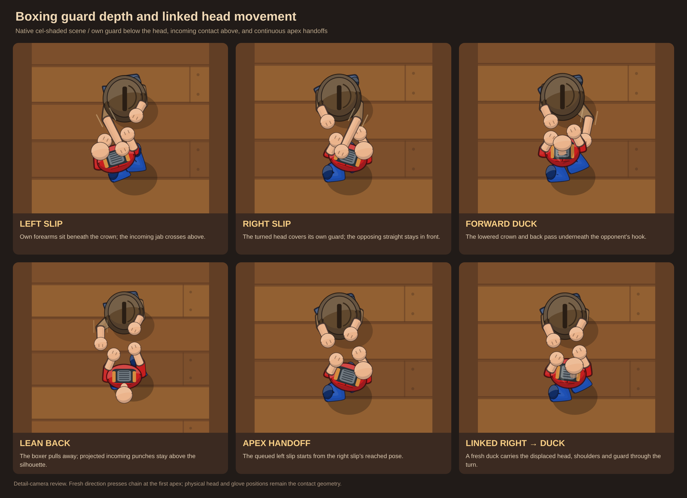

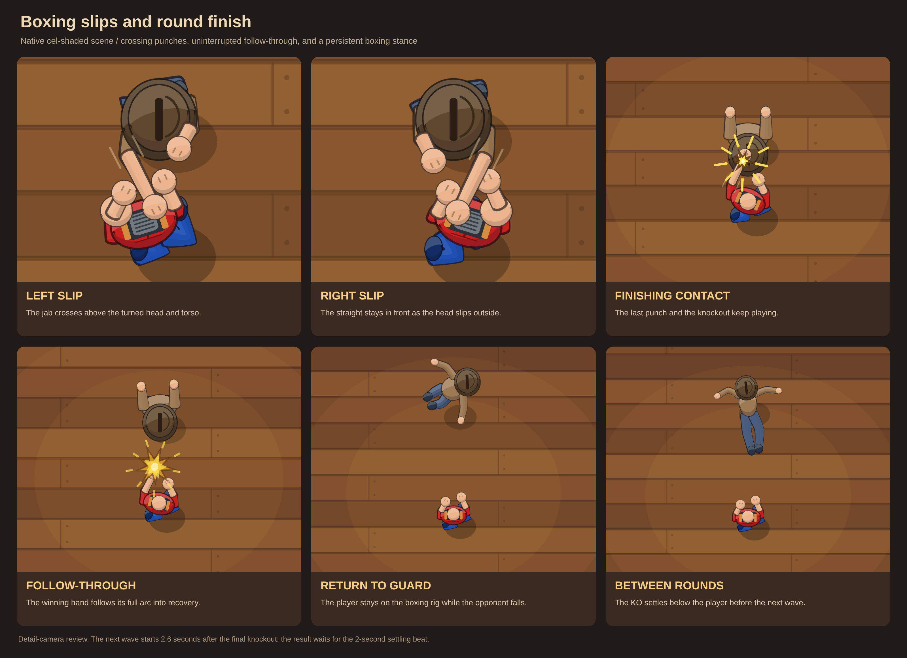

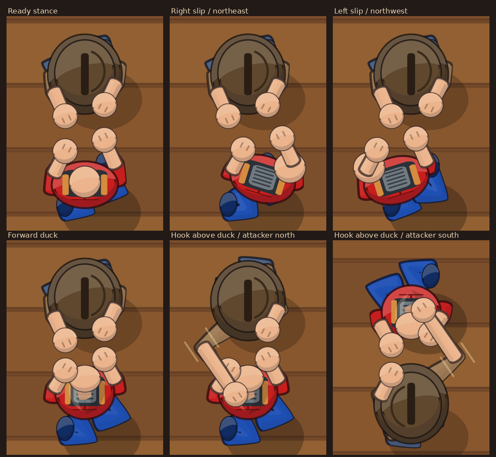


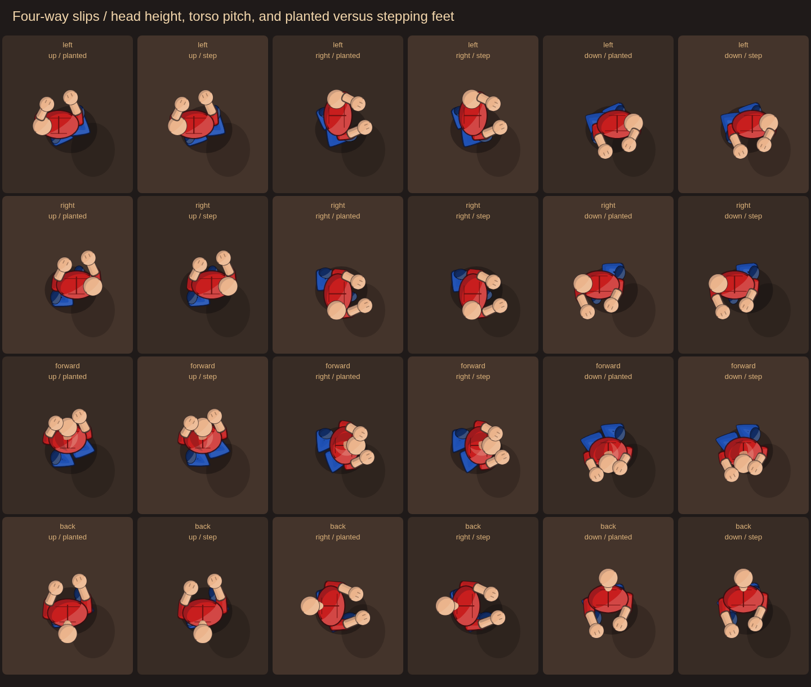

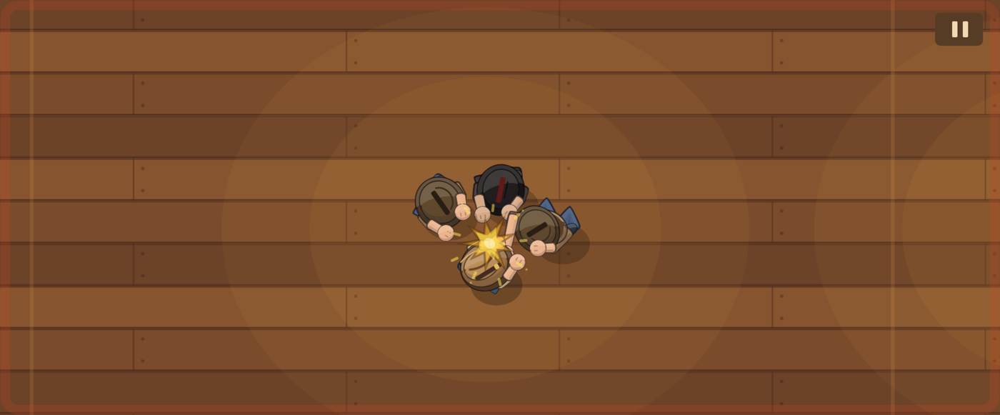

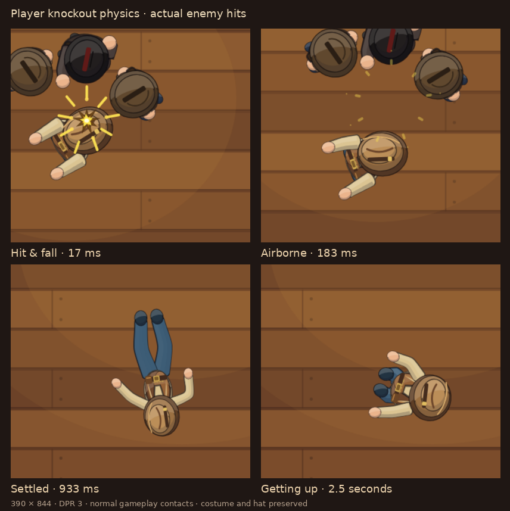

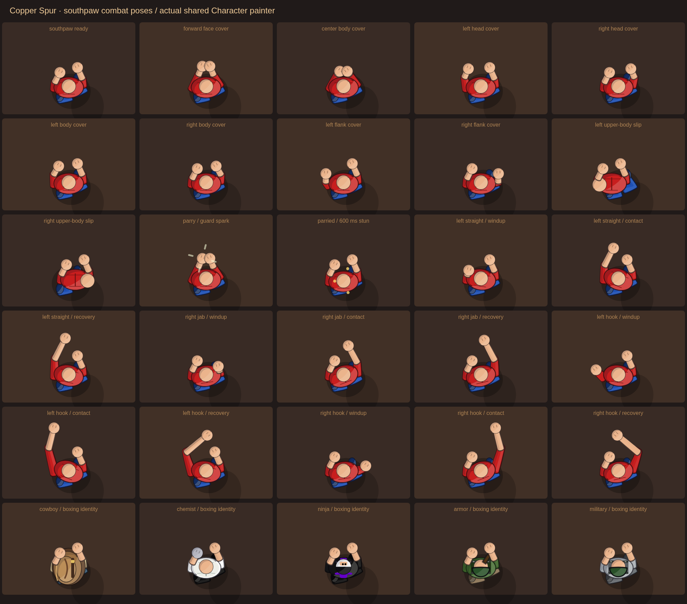

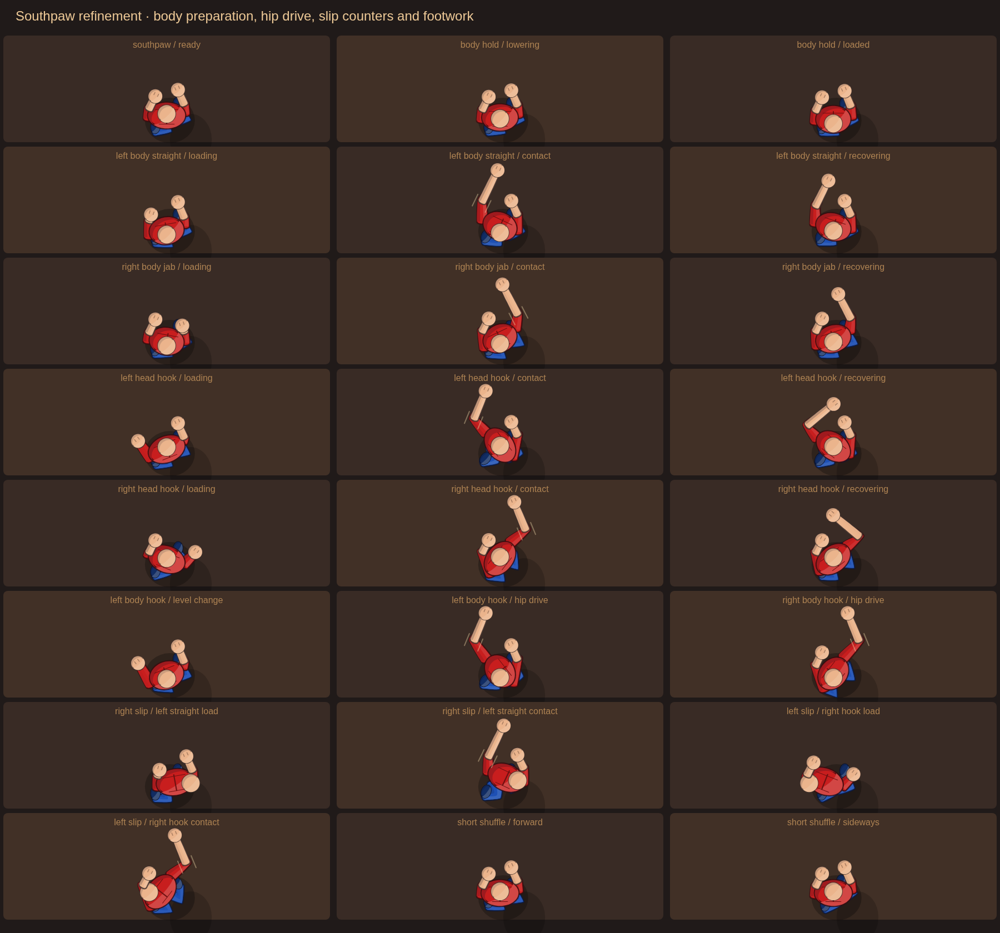

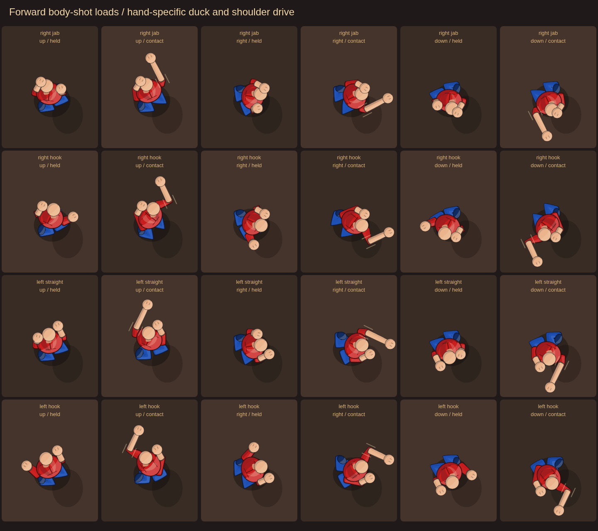

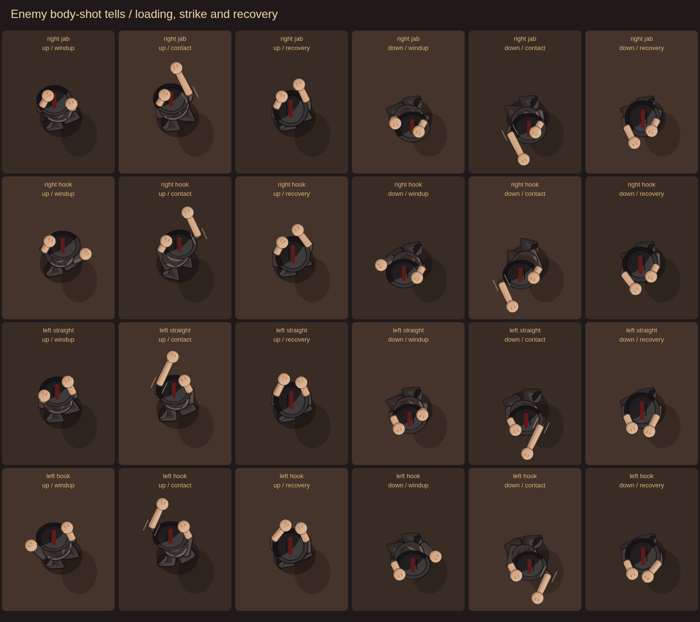

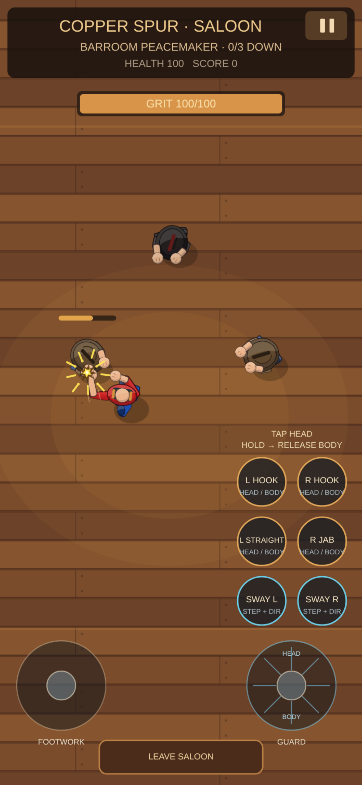

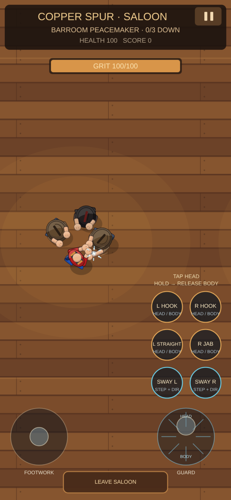


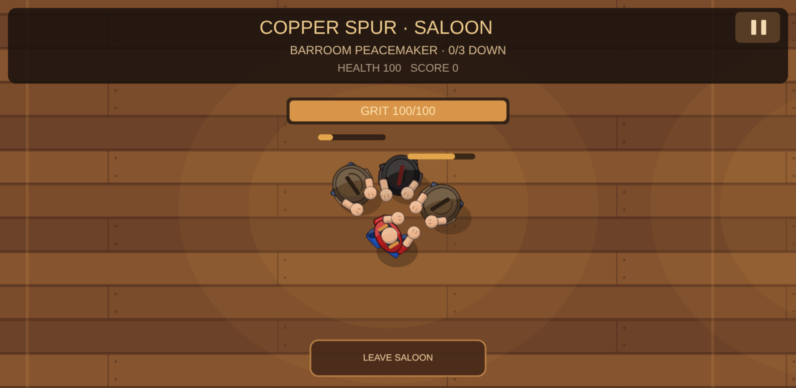

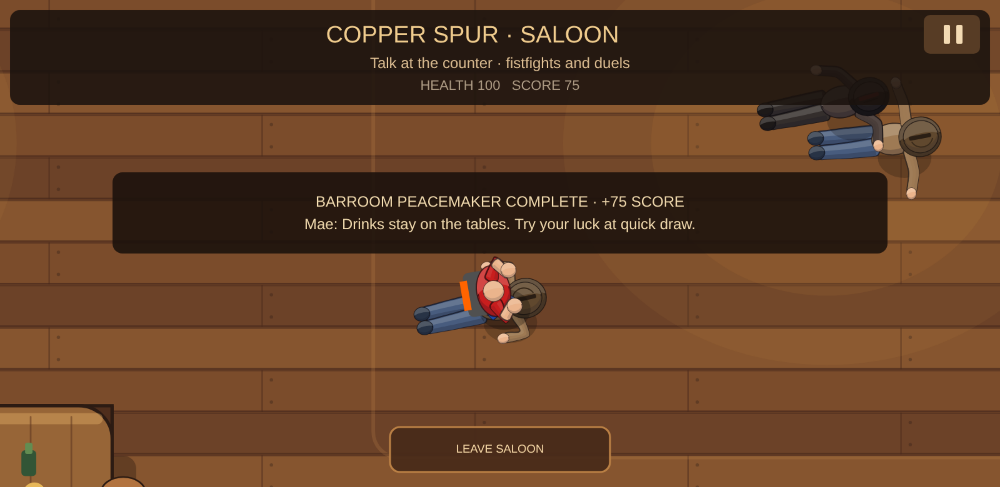


The separated-knockout update passes 41 targeted regression suites, including
historical world trajectories/painting, five local ragdoll responses, actual
duel headshot succession and prior control/gauntlet/corpse checks. Chromium
checks at 390 × 844 and 940 × 390 cover real civilian punches, player defeat,
opponent knockouts, pause/get-up, floor layering and retained boxing poses.
The final hook profile and five-profile preview also use the final source.
`check-falls-and-footwork.js:116` retains an existing rest-stance spacing
assertion failure, reproduced on unchanged baseline `c2f26d9`.
