# Dry Gulch expansion

Level 3 keeps its authored farm and western town in story mode, arcade mode and
after settlement. Streamed farmland and desert continue beyond the town, with
world-space canyon bends, layered rock faces, descending ramps and timber
crossings. Terrain height, movement and the signed lighting heightfield use the
same canyon geometry. Rock and wash planes join into continuous cached
contours, and lighting interpolates shared corner heights, keeping the terrain
free of repeated paint or shadow seams.

The canyon material pass adds uneven sandstone bedding, broken shelves,
chipped sunlit lips, mineral seams and angular talus at the wall's foot. The
floor carries meandering silt, gravel banks and wind-laid sand rather than one
flat wash. Plateau sand ridges, dry crust fractures and grouped scree remain
quiet enough to keep characters and routes legible.

Timber crossings use individual warm and weathered boards with directional
grain, occasional knots/splits, bevels, iron fasteners and capped rail posts.
Grain weights account for the world terrain texture resolution. The Peacemaker
bridge uses the same timber material, with its static deck cached once at
1276 × 316 pixels and its rails retained in the actor depth passes.

These details are baked from world coordinates, including negative chunks.
Canyon floor/rim heights, ramp widths, bridge walking surfaces and settlement
exclusions retain the existing geometry. Art does not consume the downstream
terrain/population RNG. Other biomes keep their materials.

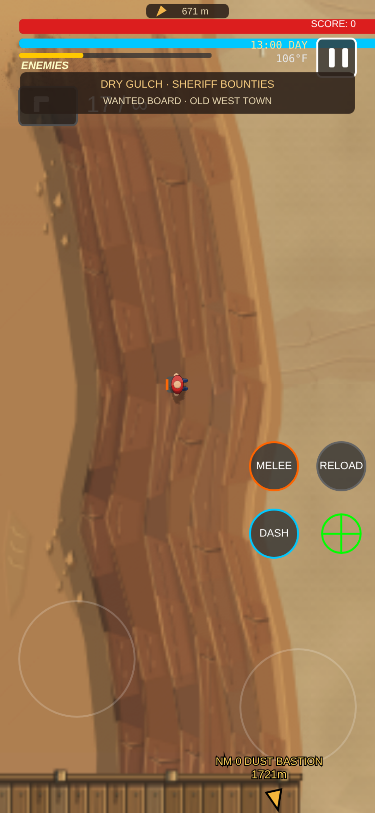

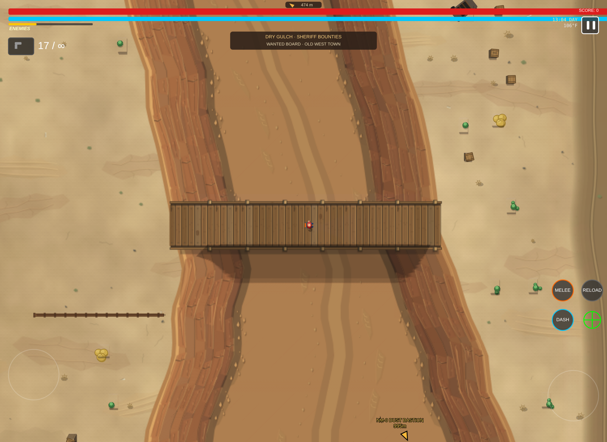

The town has 69 named premises across Main Street, Front Street, Market Street,
the mesa district and the railway avenue. The Copper Spur is a larger saloon
with its own walkable interior, counter, patrons, tables, piano and gallery.
Town doors, street signs and the sheriff's wanted board remain on return trips.

## Frontier destinations

Three satellite towns extend the desert beyond Dry Gulch. Each has twelve
named premises including homes, a working yard and a clear central street connected to
the surrounding wagon trails.

| Destination | Direction from Dry Gulch | Character |
| --- | --- | --- |
| Copper Wash | West | Mining township with a copper hoist, assay office, ore exchange and narrow-gauge sorting yard |
| Sunspur | Northeast | Orchard settlement with an adobe mission, cantina, produce market, irrigation and vine trellises |
| Mesa Relay | South | Stagecoach stop with a wheelwright, depot, hotel, freight warehouse and coach turnaround |

Split Tooth Wash adds broken red sandstone banks west of town. Redrock Basin
opens into a broad salt pan to the north, while Needle Gorge winds between
pale rock spires to the east. Their six timber bridges, nine descending ramps
and gently fading ends use the same terrain as native movement and lighting.
Town foundations have flat aprons, and the existing bounty routes remain open.
An arrival badge names each destination and fades completely after 3.5 seconds.

Six civilian occupations add miners, ranch hands, traders, smiths, travelers
and townspeople in sunbonnets. Hats, work harnesses, rope coils, leather aprons,
satchels and bedrolls retain the cel shaded character style. Dry Gulch has
twelve permanent workers, and each satellite town has a themed mix. Individual
appearance, injuries, knockdowns and deaths persist through streaming and
saving. These residents use ordinary civilian falls and remain separate from
campaign survivor recruitment.

Raised roofs and eaves now cover characters beneath their projected edges.
The wooden entrance beam and Dry Gulch sign draw above ground-level actors;
the stair treads remain below their feet. The lighting height mask follows the
same order, preventing a hidden hat from shading through the sign.

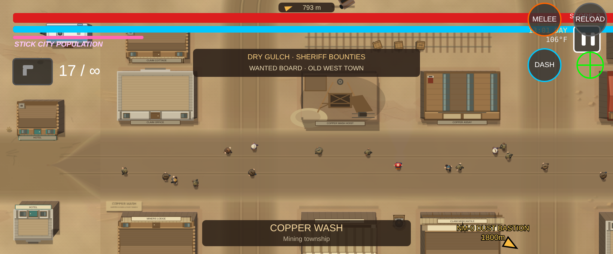

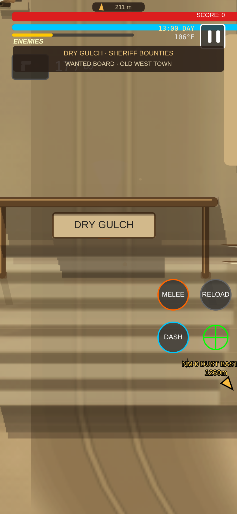

## Activities and rewards

| Activity | How to start | Reward |
| --- | --- | --- |
| Barroom Peacemaker | Enter the Copper Spur and talk to Mae at the counter | 75 score on first level-14 clear; saved survival record |
| Quick draw | Ask Mae or challenge Quickhand at the Front Street plaza | 120 score and immediate cowboy costume ownership on first victory |
| Red Mesa Raiders | Accept the sheriff's first wanted poster | 125 score after clearing Red Mesa Redoubt and returning |
| Dust Rail Gang | Accept the next wanted poster | 175 score after clearing the abandoned depot and returning |
| Coyote Creek Outlaws | Accept the final wanted poster | 225 score after clearing the mine camp and returning |

Each defeated contract outlaw also awards 5 score. Bounties keep a numbered gang
roster and surviving enemies' wounds; streaming, saving or travelling cannot
recreate a defeated outlaw or pay a completed contract twice.

The upgrade shop sells the revolver for **100 score**, including six rounds and
three speed loaders. The same price refills and equips it. Winning quick draw
immediately unlocks the cowboy costume; select **COWBOY COSTUME → EQUIP (FREE)**
in the shop to wear its curved cel shaded hat, vest and bandana. The costume is
exclusive with the ninja, explosive and chemist suits.

## Controls

Outside, approach a saloon door, Quickhand or the wanted board and use the
displayed touch button, **F**, or gamepad **A**. A finger held on an interaction
button is consumed until release so it cannot become gunfire.

Inside, use the left touch stick or **WASD** to move. Talk to Mae to choose the
brawl or duel; desktop **1/2** selects the activity. Fistfights use shared
southpaw boxing with four head/body punches, directional guards, timed parries
and four-way slips. GRIT and directional knockouts remain nonlethal. The
1400 × 980 room retains its close camera and has a clear fighting floor.
Target changes ease the camera instead of snapping it. Tap and release for
head punches; hold to lower the stance, then release for the body. Well-timed
alternating attacks after a landed hit earn quicker combos, with distinct
yellow hit bursts, block sparks and larger parry flashes.

Peacemaker is a survival gauntlet: the first six levels teach single opponents,
blocking/two-punch brawlers, small groups and a great fighter with head movement
and three-punch chains. Level 7 tackles the player through the Copper Spur's
door onto Main Street. Attacker counts and skill increase until level 14 moves
combat onto a canyon bridge, then survival continues there. GRIT carries between
waves with a small breather recovery. A 2.6-second finishing interval lets the
last punch recover and the knockout settle before the next attackers arrive;
the player keeps the boxing model between waves. Best completed level is saved; local
fighters, cinematic debris and nonlethal falls stay separate from campaign AI.

GRIT stays visible in its own upper-left bar outside the fading header. Outdoors,
the sheriff heading fades after three seconds while its compact direction arrow
and distance remain at the northern screen edge, above the campaign health and
score row.

For quick draw, the right stick aims below roughly 70% travel and fires when
pushed farther. Wait for the green **DRAW** cue and hit the opponent. Aiming
early is safe; an early shot loses and a badly aimed round can miss. Victories
advance saved challenges with farther, quicker opponents. Native death effects
stay inside the duel; rematches preserve the first-victory reward.

See [Boxing and quick draw](boxing-and-duels.md) for the complete control map,
guard sectors, contact geometry and progression rules.

The saloon's pause controls provide resume, save and leave-to-shop actions.
Saving inside preserves quest progress and exterior equipment and resumes at
the exterior position. Travelling closes the local scene before building the
next sector. Outdoor AI, projectiles, town population and campaign objectives
remain separate from the saloon scene.

## Validation

Focused checks exercise native input, combat, reward, save/load, travel,
placement and terrain/light geometry:

```sh
node tools/check-frontier-town.js
node tools/check-frontier-canyons.js
node tools/check-frontier-canyon-materials.js
node tools/check-frontier-ground-materials.js
node tools/check-frontier-bridge-materials.js
node tools/check-frontier-occlusion.js
node tools/check-frontier-settlements.js
node tools/check-frontier-settlement-routes.js
node tools/check-frontier-canyon-expansion.js
node tools/check-frontier-civilian-variety.js
node tools/check-frontier-exploration-notices.js
node tools/check-frontier-equipment.js
node tools/check-frontier-lighting.js
node tools/check-frontier-bounties.js
node tools/check-frontier-saloon.js
node tools/check-frontier-gauntlet.js
node tools/check-frontier-gauntlet-arenas.js
node tools/check-boxing-gauntlet-ai.js
node tools/check-frontier-hud-refinements.js
node tools/check-frontier-routes.js
node tools/check-frontier-integration.js
node tools/check-boxing-combat.js
node tools/check-boxing-render.js
node tools/check-boxing-world.js
```

The existing forest mission, save/load, return travel, population, render,
depth and lighting suites also cover the shared engine seams.

Chromium checks at 390 × 844 and 940 × 390 with device pixel ratio 3 verify
native-input opening-wave combat, brawler blocking/two-punch chains and ace
three-punch chains/head movement. Later-wave progression fixtures exercise the
door-tackle transition, bridge reveal, continuing survival, rail collision and
pause/save/shop isolation. The final street framing also runs 240 native frames
with actual AI contacts and a faded HUD. All captured frames balance their drawing
state and report no game errors. Separate duel/equipment checks cover early and
successful shots, costume equipment, revolver purchase and bounty acceptance.
Native walking checks reached all three outposts
through generated solids and canyon collision. The lighting check sampled the
actual canyon height buffer across floor pixels, with no false rim-height gaps;
day and night WebGL passes also verified floor, rim and roof light occlusion.

The satellite expansion adds continuous native walks from the sheriff's street
to all three town centers, all fifteen new bridge/ramp crossings and both ends
of each finite canyon. Save checks cover resident identities and injuries,
individual deaths and old numeric destruction records alongside new town keys.
Final Chromium captures exercise all three towns and gulches, the entrance and
roof draw order, and all six civilian occupations standing and knocked down.
Portrait and landscape frames report balanced drawing state and no game errors.

## Captured previews

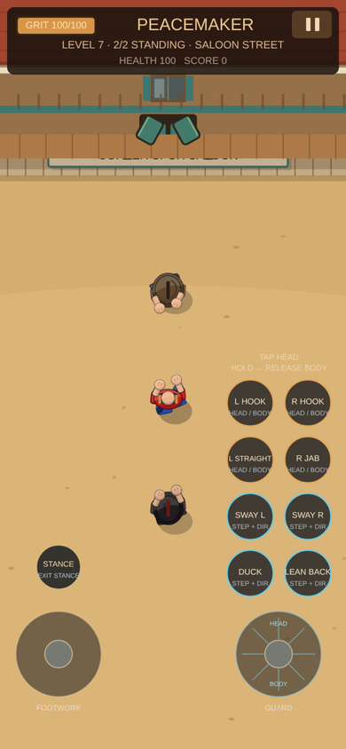

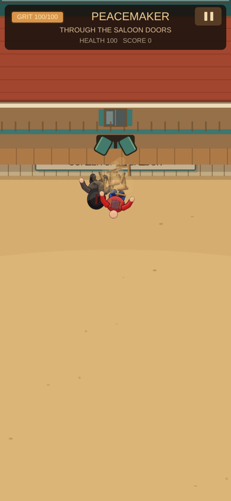

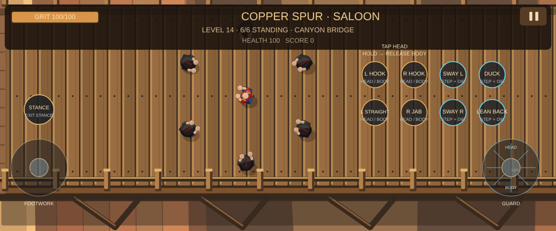

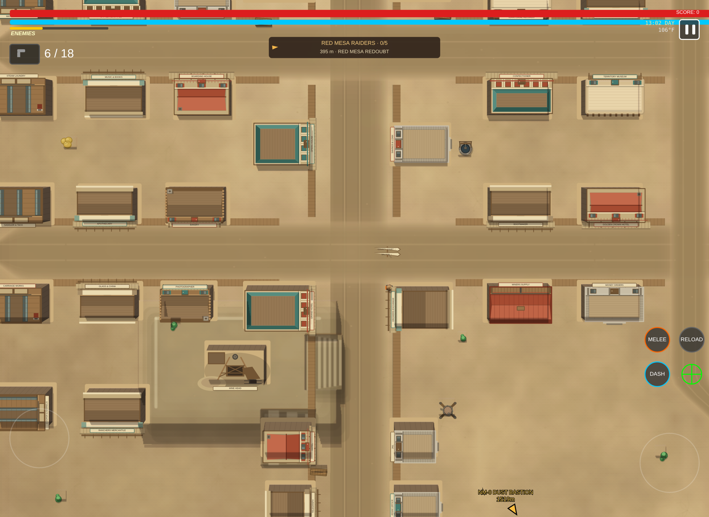

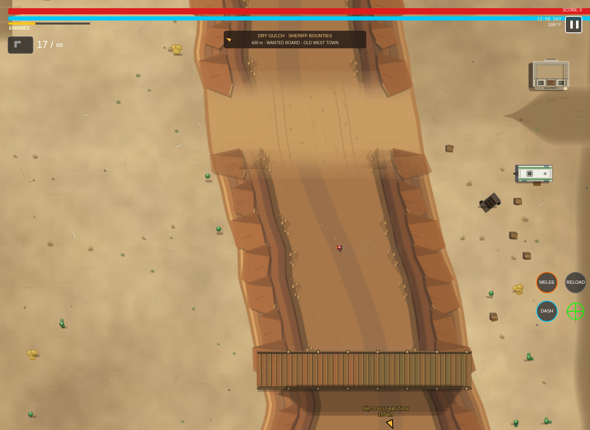

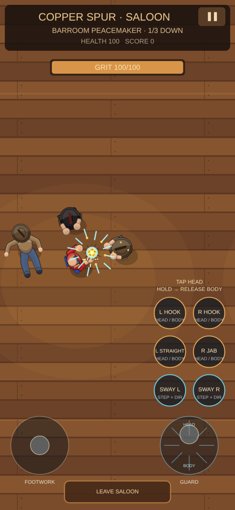

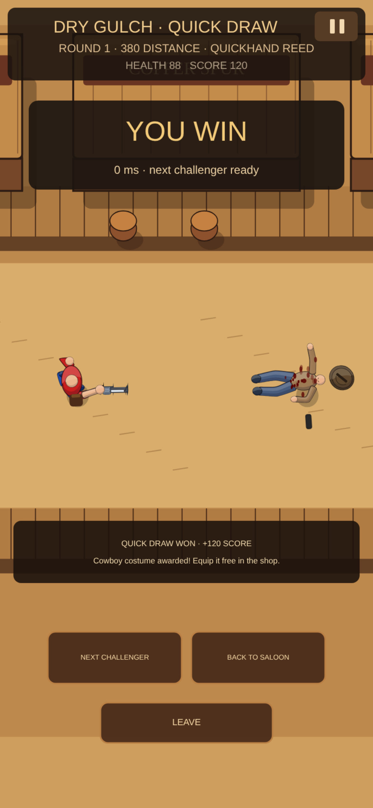

The material checks compare shared stone/ground feature geometry and timber
identity across positive and negative chunk cuts, validate bounded contour
thickness and feature reach, and exercise RNG independence and a reused bridge
deck cache. Native browser review compares day/night canyon floors, rims,
ramps, both bridge axes, close timber and stone, plateau material beds and the
Peacemaker bridge. Signed terrain height and local-light occlusion are checked
alongside the artwork; canvas count, resident chunks and world lighting target
sizes are compared with the pre-material baseline.

The reviewed material source passes the 23 selected terrain, lighting,
frontier mission and control suites. Twenty native Chromium screenshots cover
portrait/landscape material views; frame stacks remain balanced with no page,
frame or GL errors. World canvas/chunk counts and lighting target dimensions
match the baseline. The additional arena deck cache stays one 1276 × 316
pixel-density-1 object across live frames, and ground re-bakes are identical
after unrelated chunk generation. These are browser correctness/resource
checks, not measured Galaxy S25 frame rates.
