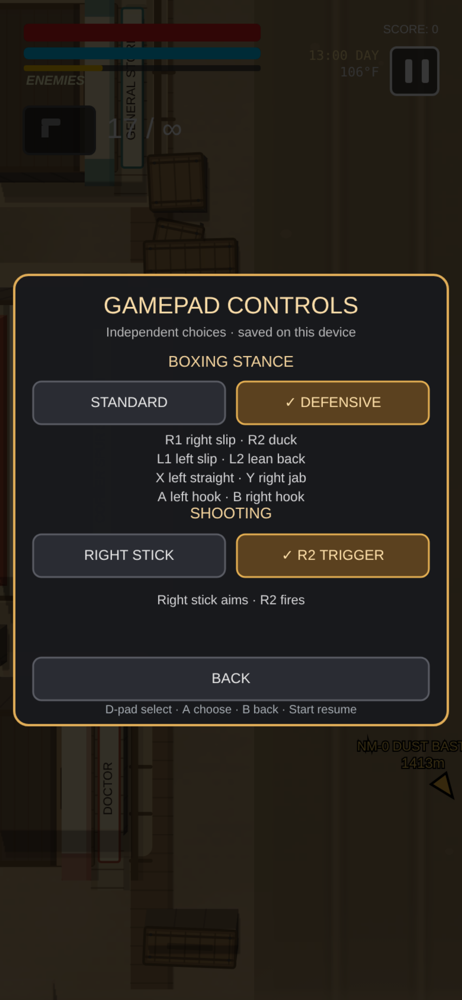

# Backbone One controls

The gameplay handler uses the browser's standard gamepad button layout.

Open **Pause → Settings → Gamepad Controls** in the world, barroom gauntlet or
quick draw. With a controller, press Start to pause, then Y for Settings and A
for Gamepad Controls. Use the D-pad and A to choose, B to go back, or Start to
resume. Touch can select every option directly.

The two preferences are independent and save immediately on this device,
separately from campaign saves. New games and loading a campaign keep them.
A fresh device uses **Standard** boxing and **Right Stick** shooting. If browser
storage is unavailable, choices work for the session and the menu says so.

- **Boxing Defensive** moves slips to the shoulders/triggers and punches to
  the face buttons, only while in boxing stance. See the exact mapping below.
- **R2 Trigger shooting** makes the right stick aim at any travel and R2 fire,
  in normal gameplay and quick draw. A centered stick uses the last facing.
  Normal ammunition, cooldowns, reloads and duel false starts still apply.
  With the bow, aim normally, hold R2 to draw and release to shoot.

Changing a scheme, resuming or reconnecting consumes held firing controls
until release/recentering. Menu selections cannot become punches or shots.
Touch, mouse, directional blocking and other controls keep their behavior.



| Control | Action |
| --- | --- |
| Left stick | Move |
| Right stick with guns/taser | Aim; outer travel fires in Right Stick mode |
| R2 outside boxing | Fire in R2 Trigger mode; hold/release to draw/fire the bow |
| Right stick with bow | Right Stick mode: reversed pull/tension; R2 mode: aim |
| L3 — left stick click | Dash |
| R3 — right stick click | Release a drawn bow; otherwise toggle headshot aim |
| D-pad up | Cycle owned melee tools: sword → pickaxe → unarmed |
| D-pad down | Unmapped |
| D-pad left / right | Previous / next available firearm, taser or unlocked bow |
| L2 | Hold/cook grenade; release to throw |
| L2 with chemist suit | Hold/cook flask; release to throw. No grenades. |
| L1 with chemist suit | Hold to charge the cannon; release to fire |
| L1 with other suits | Reserved suit ability slot; ninja parry is not implemented yet |
| A in the forest | Talk or collect at the visible hunting prompt |
| D-pad left / right during a street gang check | Select Positive, Neutral or Negative |
| A / B during a street gang check | Confirm the selected reply / leave neutrally |
| X | Reload; cannot manufacture arrows |
| Y or R1, without chemist suit | Existing melee attack/finisher input |

The selected shoulder layout is **L2 flask / L1 cannon** for the chemist suit.
The chemist's former Y/R1 flask aliases are removed. A/B no longer cycle guns
or toggle headshot aim. L1/L2 no longer trigger dash.

Melee cycling uses the existing owned-tool list. Firearm cycling wraps in both
directions through pistol, story-mode taser, unlocked bow, SMG or dual SMG, assault rifle,
shotgun and rocket launcher as available; dual SMG replaces single SMG in the
list. Simultaneous new left/right presses cancel. Existing 300 ms firearm
and headshot debounce and dash unlock/cooldown restrictions remain.

Button history is captured after the frame's actions, so a new press can be
detected before history changes. Holding an edge-triggered button does not
repeat its action. Grenade/flask/cannon holds merge with touchscreen input
and feed the existing cooking/charging and release mechanics. A missing
controller clears button history so reconnection can detect a new press.

A connected controller hides the touch action buttons (reload, melee, dash,
headshot aim, grenade or chemist abilities) and both joystick circles, even
when the controller is idle. Touching the screen cannot reveal them while
the controller remains connected. The health, ammo, score and objective HUD
stay visible. Disconnecting restores the touch controls when using touch
input; keyboard/mouse use keeps its existing joystick visibility behavior.

With **Right Stick** shooting and the bow, pull the right stick **back**,
opposite the intended arrow line.
For example, pull left to shoot right. Draw smoothly toward full travel: the
stick distance moves the string, while the speed and steadiness of the pull
determine arrow power. A sudden full-stick jab fires a short, weak dud; holding
that jab cannot build power afterward. The small quiver readout shows tension,
DUD/SMOOTH/READY and release feedback.

Release by letting the stick return to its deadzone, reaching its full end stop,
or clicking R3 while drawing. Each draw fires once. Recenter after an end-stop
or R3 release before drawing again. R3 keeps its existing headshot-toggle action
with other weapons. Wildlife headshots always depend on which body/head surface
the projectile reaches first, regardless of that toggle. Weak/dud arrows cannot
claim an instant PERFECT hunting headshot.

Touch aiming uses the same reversed pull and release gesture. On desktop, aim
toward the target with the mouse, hold the primary button to draw, then release
to fire. Pause, menus, cutscenes, travel, weapon changes and input-device changes
cancel an unfinished draw without firing. Draw state is transient and never
saved.

Boxing keeps the right stick guarding eight directions in both schemes.

| Boxing action | Standard | Boxing Defensive |
| --- | --- | --- |
| Left straight | L2 | X |
| Right jab | R2 | Y |
| Left hook | L1 | A |
| Right hook | R1 | B |
| Slip left | X | L1 |
| Slip right | B | R1 |
| Duck forward | Y | R2 |
| Lean back | A | L2 |
| Exit boxing stance | D-pad up | D-pad up |

Left/right slips avoid the centerline of straight punches; timed ducks and
leans can clear head hooks. A forward-held left stick steps into the duck,
and a backward-held stick steps back with the lean. A stationary slip moves
the upper body without translating the feet. The right stick keeps guarding.

Tap and release a punch for the head; hold at least 180 ms to lower
the stance, then release for the body. Press the opposite hand just after a
landed hit for a timed combo. D-pad up returns to the equipped weapon outdoors.
A never talks or interacts during the stance: leave boxing before pressing A
for those actions. The exit press is consumed, so holding D-pad up cannot
immediately cycle melee tools. Entering fists cancels an unfinished bow pull without
firing or spending an arrow. Quick draw uses the selected shooting scheme: the
original outer-stick threshold or R2 with unrestricted stick aiming.
See [Boxing and quick draw](boxing-and-duels.md).

Connecting a controller also hides boxing tutorial overlays and the on-screen
stance exit badge. D-pad up still leaves the stance; pause and saloon mission
buttons remain available. Saloon and duel control hints disappear while a pad
is connected; GRIT, ammunition and duel cues still appear briefly under the
saloon's 3.5-second text fade. In Standard, native R1
entry into unarmed boxing uses the same right hook as R1 during the fight;
the held Y entry alias keeps its one left straight on release without also
ducking. The next fresh Y press is a duck. In Defensive, native Y entry prepares a
right jab; held R1 raises the stance without a punch and needs a fresh press
to slip right. Slips do not repeat on a held button;
pause and reconnect consume buttons already held. B retains its usual back or
resume action inside menus; after that press lifts it becomes the selected
stance action (Standard right slip or Defensive right hook).

In the saloon, leaving the stance preserves an active bout and freezes enemy
attack turns. A can then talk to Mae. RAISE FISTS or a fresh mapped punch
resumes the same fighters and GRIT, without drawing the exterior gun indoors.
In Defensive, fresh X/Y punches can resume the bout; A/B keep their
interaction/back actions until the stance is raised. Touch adds DUCK and
LEAN BACK buttons; desktop C/V perform these two slips.

Verification uses a simulated standard-layout pad through the real touch,
gamepad, desktop and player update paths:

```sh
node tools/check-gamepad.js
node tools/check-gamepad-settings.js
node tools/check-boxing-defensive-controls.js
node tools/check-gamepad-trigger-shooting.js
node tools/check-boxing-gamepad-refinements.js
node tools/check-boxing-four-way-input.js
node tools/check-boxing-longitudinal-slips.js
node tools/check-bow-draw.js
node tools/check-hunting-ballistics.js
```

It checks actual dash, grenade/flask creation, cannon discharge, melee and
reload; first/held/released buttons, cooldown and unlock gates, bidirectional
gun/taser cycling, owned melee tools, unmapped down, reserved L1, simultaneous
shoulders, touchscreen coexistence, axes/deadzone and disconnection/reconnect.
It also captures the actual HUD labels and circles to verify hiding on idle
detection, during pauses and after touch events, then restoration on disconnect.
The boxing controller checks cover each anatomical hand on tap and body hold,
pause and disconnect cancellation, native R1/Y entry, and actual hidden tutorial
shapes and labels while keeping scene actions and gameplay state visible.
The four-way input suite exercises every face button's first/held/released,
paused and reconnected edges, stance exit and fresh A interactions, preserved
saloon bouts and touch/shoulder reentry, plus non-overlapping mobile controls
at 320 × 568, 390 × 844, 800 × 390 and 940 × 390.

`check-bow-draw.js` follows actual gamepad/touch/desktop and Character update
paths through smooth draws, jab duds, neutral/end-stop/R3 releases, recentering,
finite ammunition and interruption. `check-hunting-ballistics.js` verifies
first anatomical contact, cover ordering, weak-arrow quality and pooled reuse.

The settings suite exercises stored preference validation, storage failure,
independent choices, new-game retention, real menu touch/controller actions,
held inputs, and paused saloon/duel clocks. Defensive checks cover all eight
bindings, head/body holds, guard sectors, unchanged combo timing, late dodge
links, native stance entry, exit, pause and reconnect. Trigger shooting checks
follow all eight native weapons, finite ammunition and cooldowns, R2 bow draw,
touch/mouse coexistence, and quick draw projectiles, false starts and deaths.
