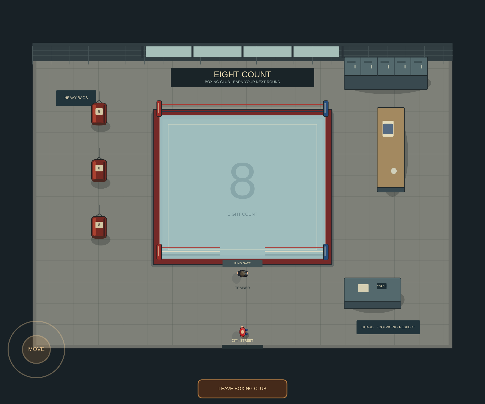
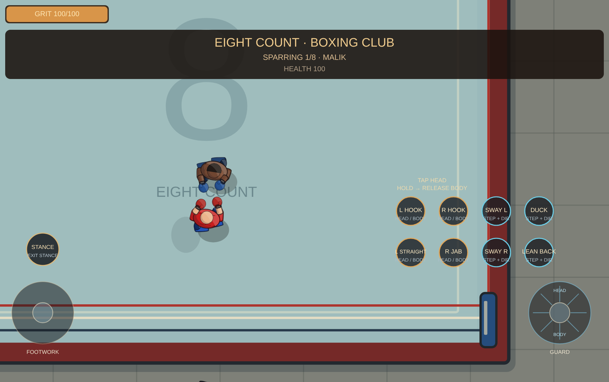

# Level 1 relay territory and Eight Count

Owning Stick City's starting fortress and the original NM-0 relay opens the
connected territory between them. The original city tower ambush must finish
first, including when the player captures the relay before the starting fort.

Regular city residents can then stream into the former NM-0 exclusion areas.
These are the existing ambient pedestrians, confident residents and street
gang members, with their existing appearance and behavior. They are separate
from the Directive's owned population and do not add department recruits.
Their existing off-screen arrival rules, population cap and streaming cadence
remain in place. A remote relay battle does not empty safe captured city areas.

Hostile arrival routes reject the connected owned territory and a 1,500 HUD
metre buffer measured from each owned fortress's outer boundary. One HUD metre
is ten world units. On capture, hostiles in the protected area retreat without
awarding kills, score or loot; the old city gate's pending reserve also retreats.
The initial city tower fight retains its original reachable approaches and
must still be completed. Breaching another city gate after full control opens
the road without starting a distant, unreachable enemy muster.

## The next relay

Capturing the original relay reveals **NM-0 SOUTHWEST RELAY FORT** and updates
the existing fort direction/distance HUD. Its compound has 1,500 HUD metres of
clear ground southwest of the original relay's compound. Measuring this from
the compound edges keeps the hostile fort outside the new protected buffer.

The successor uses the same gate, two towers, finite garrison, 30-person
opening muster, 120 reserves, refill cadence and capture/Directive rules. Its
gate damage, tower damage, garrison, battle and capture scene have independent
save records. Capturing it extends the protected connection and releases its
civilian exclusion area. Existing primary fort saves retain their numeric key;
the successor uses `outpostForts['1:RELAY_SW']`. Other biomes keep one fort.

## Eight Count boxing club

The city boxing doorway unlocks after ownership of the starting fortress and
original relay, without requiring the southwest relay. Enter at the real
exterior doorstep with its touch button, **F**, or gamepad **A**. Carrying a
shovel retains the existing F-to-dig binding; touch remains available.

The private interior reuses the Copper Spur activity scene and native boxing
controls. It contains a ring with a south gate, three heavy bags, lockers,
benches and an approachable trainer. Talk to the trainer to start sparring.
Eight named opponents have distinct skin palettes, shirtless muscular torsos
and compact eight-ounce gloves. The player receives temporary matching-size
gloves during sparring. Hand/contact geometry, punch timing, guards, dodges
and native nonlethal knockouts use the existing boxing solver.

Only one opponent is active. After a knockout settles, the player can ask the
trainer for the next round, stop or leave. After eight opponents the circuit
can be replayed. A player knockout uses the existing recovery and penalty.
Sparring never creates campaign kills or unlocks the western gauntlet rewards.
The bags furnish the room; they do not add a separate training minigame.

Exiting restores exterior position, outfit, weapon, mount and melee selection.
Saving inside resumes outside with the selected weapon and exact ammunition,
reserves and horse appearance preserved. An unfinished circuit restarts on the
next visit; the club unlock follows the saved fortress ownership.

## Validation

`node tools/check-relay-territory.js` covers 57 progression, territory, spawning,
independent persistence and mixed-battle checks. `node tools/check-city-boxing-club.js`
covers 118 entry, real keyboard/gamepad/touch dispatch, native contact, eight
sequential rounds, knockouts, pause, exit and exact equipment restoration checks.
The first opponent is defeated through native E/guard input; later test
knockouts exercise progression rather than claiming a complete playthrough.

`node tools/visual-city-boxing-club.js` checks the actual city world/HUD entry
and 375 club frames in Chromium with p5 1.9.0, portrait 390×844 and landscape
940×590 at DPR 2. It checks browser/frame errors and balanced canvas state.
The overview preview uses a wider review-only camera to show the room.

Existing fortress, population, save/load, travel, biome, hostile frontline,
NM-0 batch and saloon/boxing regression suites remain applicable. The mechanics
source guard pins the 13 reviewed territory/fort identity changes with explicit
before/after hashes and preserves the other exact combat and tuning guards.
No dependencies or rendering resolution changed. This feature work was tested
in the harness and desktop Chromium; it was not measured on a Galaxy S25.
