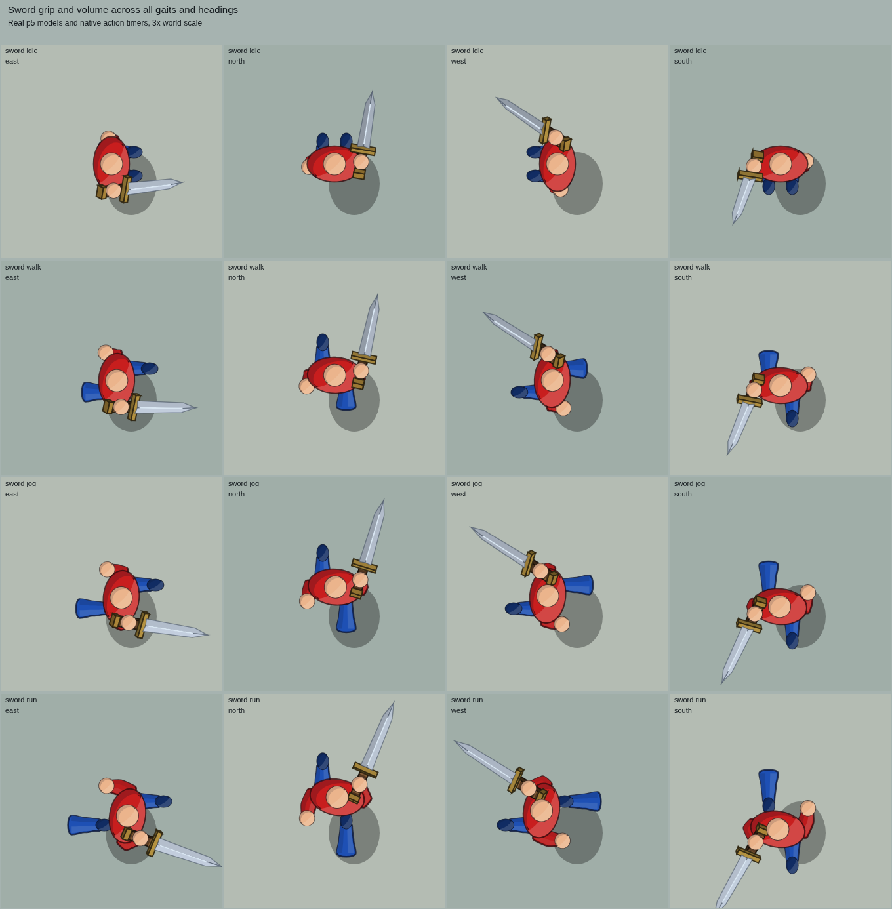
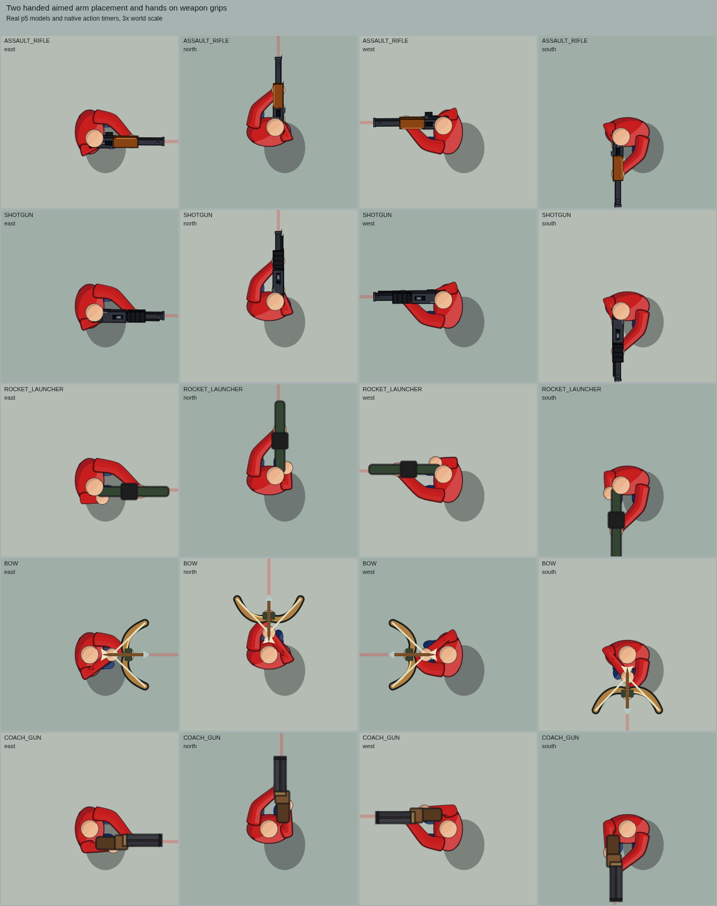
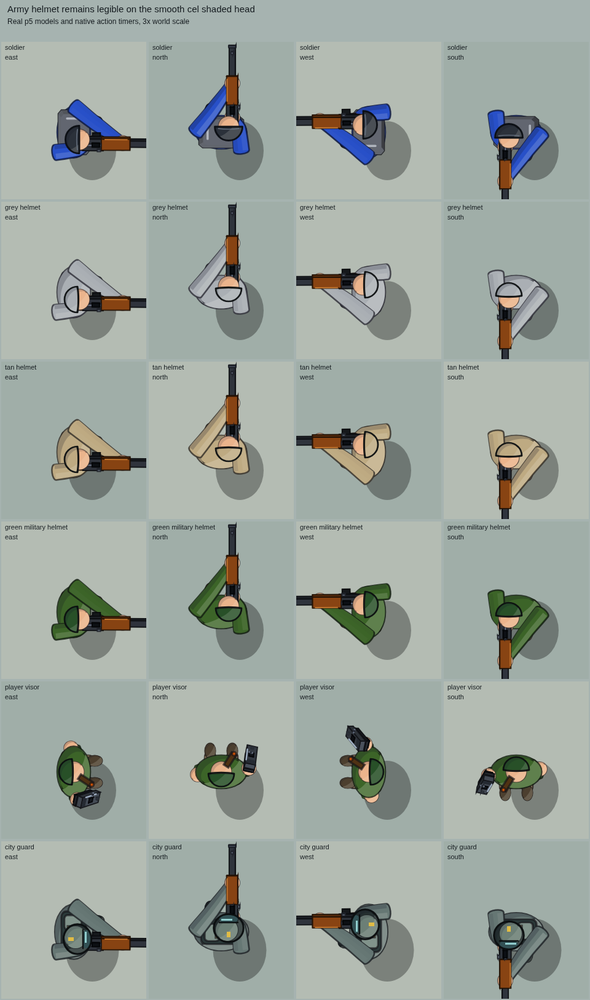

# Soft cel shaded player animation

The player and entity bodies retain the softer curved surfaces of the 3D model
update. Army helmets keep a dark shell perimeter and brow edge so they remain
distinct from the head. Clothing and skin use their original material contours.

Sword and pickaxe handles sit beneath the palm, with the guard, blade or tool
head outside the fingers. Their projected meshes share cel shaded material
planes between idle, walking, jogging, running and attacks. A controlled wrist
keeps the running sword steady. Windup, slash, backhand, finisher and recovery
use connected limbs and return both arms to the current stride.

While aiming a two-handed weapon, the shoulders sit inside the torso and the
elbows bend toward the ribs. Rifle and shotgun hands stay on the projected
grips through recoil and pumping; bow hands contact the grip and string.
Two-handed walking, jogging and running carry positions remain unchanged.

The pistol's free arm has a restrained stride beside the ribs when carrying or
aiming. Reloads, grenade throws and chemist cannon actions keep priority over
that stride. Punches retain curved sleeves even when aim input interrupts the
boxing guard. Hit windows, ammunition, fire rate, movement and harvesting are
unchanged.

## Browser previews

These are actual p5 renders at three times world scale.

Native 60 fps motion clips:

- [Sword running](previews/player-animation-sword-run.mp4)
- [Sword slash, backhand and finisher](previews/player-animation-sword-combos.mp4)
- [Pistol carry and aimed running](previews/player-animation-pistol-run.mp4)

## Validation

Focused checks pass: sword/pick animation 18, soft surfaces/helmets 167,
character 79, long-gun 33, and punch surfaces 6 across 336 poses. They cover
melee grip layering and strike timing, free-arm stride continuity, aimed grip
contact, helmet detail and protected soft surfaces.
Baseline comparisons preserve the female pistol model, corpse artwork,
two-handed carry positions and punch fist positions. The character, handgun,
long-gun, left-action, figure-volume, render, depth, city, fall, resource, bow,
robot and airborne checks pass.

Browser review passed 696 native and enlarged pose cards and 164 native motion
frames. Forty female/corpse poses match the previous pixels exactly; 1,280
two-handed carry arm/hand poses retain their previous positions. Native Canvas
and p5 fallback paths match pixels and painter state across 480 poses.

Six mobile touch scenarios passed movement, aiming, firing, melee, grenade
release and the chemist cannon on a 390 × 844 viewport with device pixel ratio
3. No JavaScript errors or unbalanced painter state occurred. This is browser
emulation, not a device FPS measurement.
