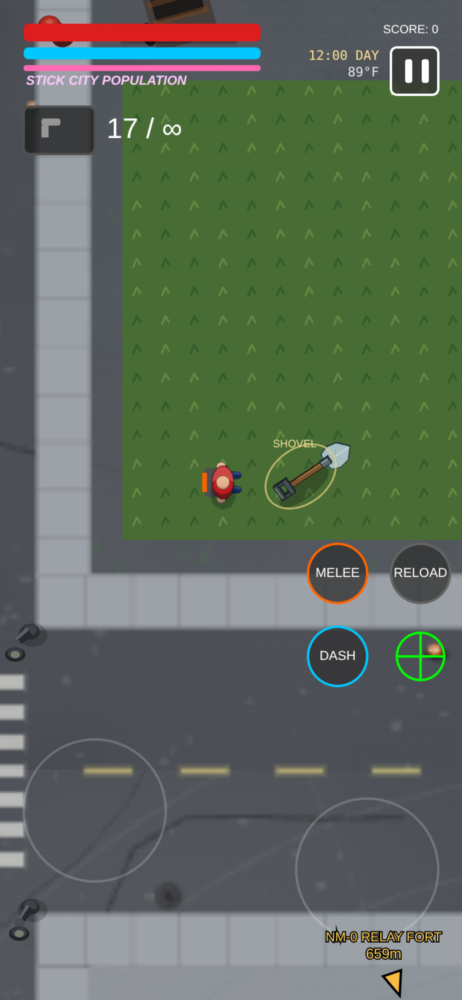
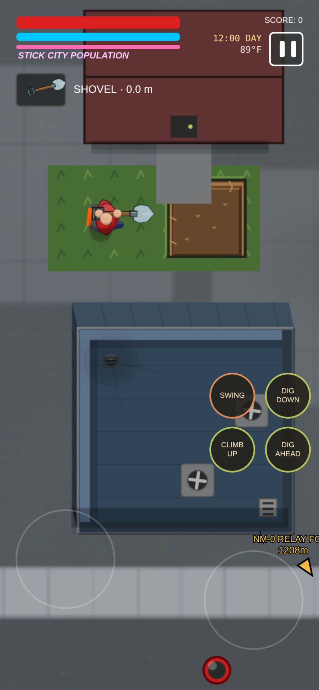
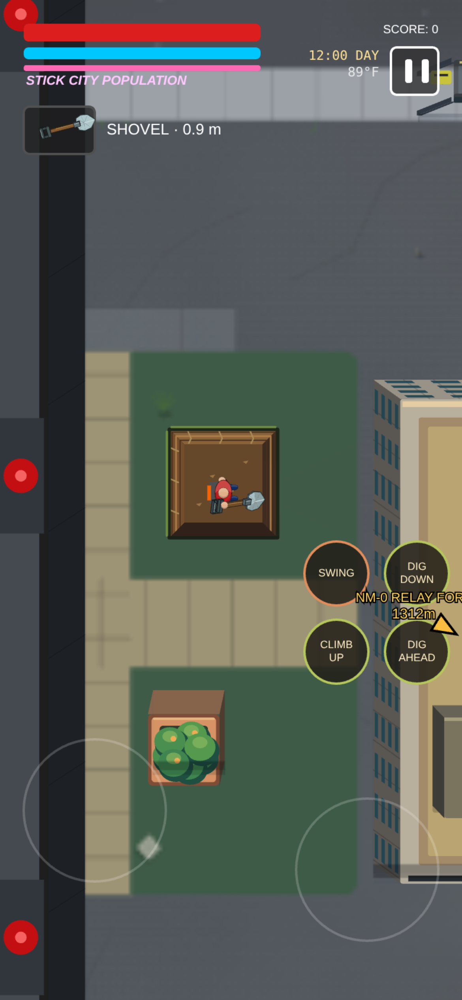
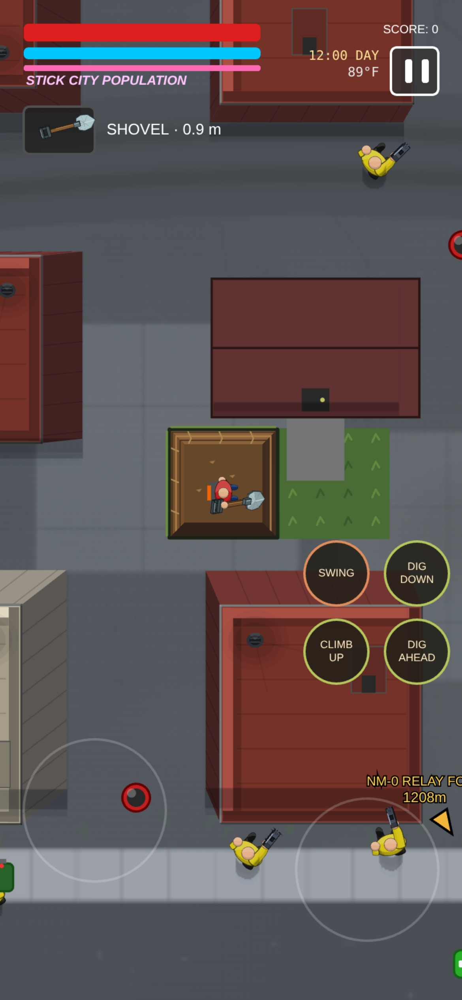
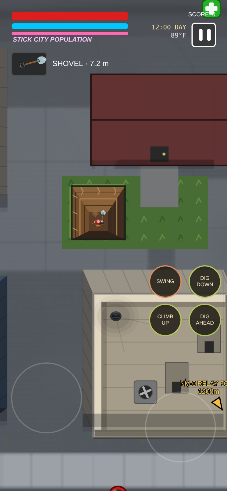
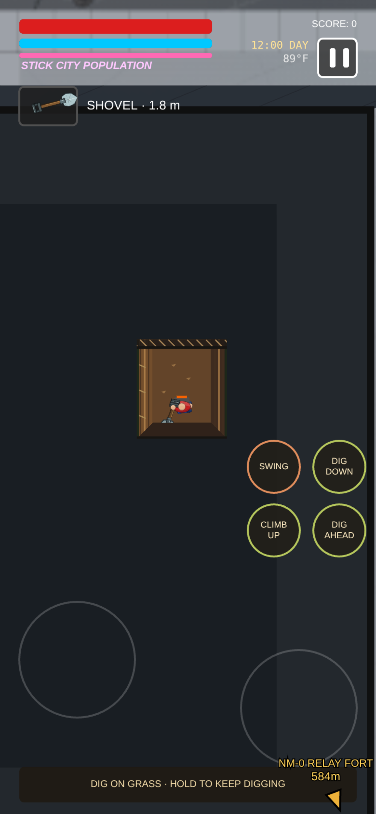

# Shovel and passive route

For debugging, the player starts with **SHOVEL** in inventory, available through
the existing melee cycle in the pause menu and on gamepad D-pad Up. It starts
unequipped. `SHOVEL_DEBUG_OWNED` controls this temporary inventory grant.

A separate shovel still appears at a pseudo-random grass location **inside
Stick City's Great Gates**. Walk over it to discover and equip it. The location
persists across saves, and collecting it does not duplicate the inventory entry
or respawn the ground item. Combat upgrades are not required. Its cel shaded
model has a wooden shaft, D-grip and a raised, ridged steel spade.



The shovel has four actions:

| Action | Touch | Keyboard | Gamepad |
| --- | --- | --- | --- |
| Nonlethal swing | SWING | E | R1 or Y |
| Dig beneath your feet | DIG DOWN | C | L2 |
| Dig the adjacent square ahead | DIG AHEAD | F | R2 |
| Climb the shaft | CLIMB UP | V | B |

The movement stick/WASD moves normally. The right stick or mouse sets the
direction of a forward dig. While the shovel is equipped, aiming and digging
cannot fire a gun or release a suit's throwable. Hold a dig/climb control to
repeat the action; each action waits for the previous scoop and descent.
Controller players keep the compact tool/depth status without touch buttons.

Digging uses a planted, bladed stance with both hands fitted to the same rigid
shaft: right hand forward and left hand at the rear grip. Downward strokes lift
and drive the spade into the ground; forward strokes point slightly downward
and scoop ahead. The 440 ms stroke resolves dirt clods and dust at blade contact.
The player starts descending at that contact and can move again after recovery.



A swing uses the existing nonlethal punch knockout and recovery. It does not
remove HP, harvest materials, charge a lethal finisher or create a shockwave.
Civilian falls remain separate from the saloon's boxing knockout physics.

## Excavation

New surface shafts and forward scoops penetrate **grass and dirt only**, including
existing courtyard lawns, forest soil, farm fields and Dry Gulch's desert/canyon
floor. Asphalt streets, sidewalks, stone paths/plazas, concrete pads, car parks,
water and bridge decking reject surface digging. Ground does not need a special
grass collider or belong to a marked route. Fully underground, tunneling can
continue beneath paving, gates and boundary walls. Actual building foundations
block the whole excavation square at every depth. The added home and gate lawns
remain as optional discovery and entry points.



The first downward scoop makes a waist-deep square. Further scoops deepen the
shaft, lowering and shrinking the player smoothly. The visible opening is
smaller than the mining grid, and the floor and strata converge with depth at
the same ratio as the figure. At full underground depth, a small local cutaway
with ceiling hatching also narrows as the player digs deeper.
The surrounding surface and any gate remain above the player. Very deep shafts
eventually reduce the figure to a pin-sized silhouette; depth is capped at 4096
world units to keep numeric behavior bounded.

At ground level, a forward scoop opens only one adjacent waist-deep square.
Repeated digging from outside cannot deepen it: enter the hole first. Below
ground, forward digging opens adjacent earth at the player's current height
and retains the roof above it, allowing player-chosen tunnels beneath paved
surfaces, gates and boundary walls. Walls still block waist-deep movement:
dig fully underground before passing underneath. Movement checks the whole
player footprint and intervening excavated space, so unmined soil and
disconnected holes remain solid.

Climbing raises the player within the shaft without deleting its lower floor.
A covered tunnel can be opened into a new exit only through grass or dirt;
move beyond paving and solid walls before climbing out. Existing open shafts
always remain climbable. Building foundations remain protected underground.
Surface attacks cannot hit a fully underground player, and the shovel cannot
hit opponents on a different level.

Grounded players, enemies, civilians and bodies accelerate into an open
hole's visible mouth. Drop height determines descent time: deep falls stay
near the rim at first and progressively shrink toward the floor. Blood,
comic impact bursts, dust and dirt clods follow the same projected depth and
size. Buried splatter stays on the shaft floor instead of staining its roof.
An intact tunnel roof supports actors above it, and aircraft remain airborne.

An uninterrupted fall of **10 metres or more** (200 world units) kills a living
actor on landing, creates blood splatter and leaves a corpse at that depth.
The player's shield cannot absorb the impact. Normal paced digging and
climbing remain safe because each scoop is a controlled change of level.
Midair deaths transfer their remaining fall to the corpse; saving and loading
retain the player's fall origin and velocity. Fatal falls preserve ordinary
city, military, fortress and bounty casualty accounting. Deployed workers'
losses are recorded in their home department so they do not return on reload.

Fully underground actors are hidden from surface enemies. Hostiles can search
the last place they saw a target, but cannot track a buried target's live
position, aim through the floor or alert others from hidden movement. Existing
homing shots coast while their target is concealed. Actors in connected
excavated space can perceive one another at compatible depths.

## Passive route

Dig and walk your own fully underground passage out of Stick City's enclosure.
Any north/south Great Gate or east/west curtain wall can be crossed, and the
passage can start anywhere inside and turn freely. There is no prescribed
entry lawn, tunnel corridor or exit patch. Once the player clears the outer
wall, **PASSIVE ROUTE** unlocks the pause menu's overworld and normal southward
travel. The unmapped Sector 09 remains unavailable.

This check leaves gate health, transmission towers, enemy forces and population
rewards unchanged. Stick City remains unliberated until its ordinary story is
completed. Loading outside, teleporting, standing in a shallow pit or crossing
undug soil cannot award the route. A legitimate save partway through any tunnel
can resume the continuous city-origin crossing, including saves made with the
older Great Gate tracker. Pickup location, ownership, tool selection,
excavations, player depth, climbing height and passive-route progress survive
saving and travel.

## Checks

```sh
node tools/check-shovel-tool.js
node tools/check-shovel-terrain.js
node tools/check-shovel-dig-animation.js
node tools/check-shovel-falling.js
node tools/check-shovel-fall-impact.js
node tools/check-shovel-depth-effects.js
node tools/check-shovel-surface-entry.js
node tools/check-shovel-awareness.js
node tools/check-shovel-foundations.js
node tools/check-shovel-render.js
node tools/check-shovel-passive-route.js
node tools/check-shovel-integration.js
```

These checks exercise native melee, dig actions, movement, input dispatch and
the complete campaign save/load path. Browser review additionally uses real
p5/WebGL at portrait and landscape phone sizes, including touch digging on the
existing west-side courtyard lawn, a player-created westward tunnel, intact
gates, save/load, and actual passive travel to Level 2.






